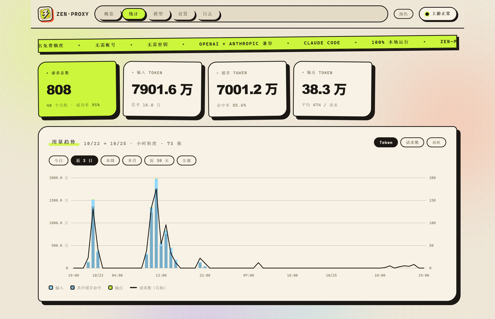
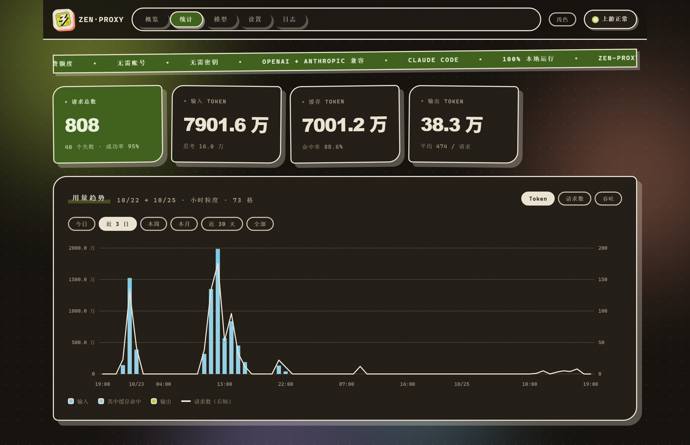

<p align="center">
  
</p>

<p align="center"><b>zen-proxy</b></p>
<p align="center">在任何 AI 编程客户端里使用 OpenCode Zen 的免费模型。</p>
<p align="center"><sub>无需注册。无需 API Key。兼容 OpenAI 与 Anthropic 接口。全程跑在你自己的机器上。</sub></p>

<p align="center"><b>简体中文</b> &nbsp;·&nbsp; <a href="README.en.md">English</a></p>

<p align="center">
  <a href="LICENSE"></a>
  
  
  <a href="#任意-openai-兼容客户端">
    
  </a>
  <a href="#claude-code">
    
  </a>
</p>

<p align="center">
  
  <br />
  <sub>
    <a href="assets/brag-demo.mp4">▶ 带声音的完整视频</a>
  </sub>
</p>

> 这是 [`12errh/zen-proxy`](https://github.com/12errh/zen-proxy) 的个人修改版。上游功能全部保留，另外加了几项本机用得上的东西，见 [本版新增](#本版新增)。

---

## 开始使用

### 安装

```bash
curl -fsSL https://raw.githubusercontent.com/12errh/zen-proxy/main/install.sh | bash
```

```powershell
irm https://raw.githubusercontent.com/12errh/zen-proxy/main/install.ps1 | iex
```

<sub>安装就这一步：不需要注册、不需要 API Key、不需要 `npm install`。装完挑一个客户端接上即可。</sub>

> 上面两条装的是上游原版。想要本修改版的统计页与中文面板，克隆本仓库后用 Bun 启动即可：`bun zen-proxy.mjs`（必须是 Bun，原因见下面「为什么需要代理」）。

---

### Claude Code

```bash
zen-claude
```

<sub>Linux、macOS、Windows 上用法完全一致。</sub>

它会按需启动代理、把当前可用的免费模型全部放进 Claude Code 的 `/model` 选择器、运行 Claude Code，并在你退出时把代理停掉。你原有的 Claude Code 配置不会被改动。

---

### 任意 OpenAI 兼容客户端

| 填什么 | 值 |
|---|---|
| Base URL | `http://127.0.0.1:8787/v1` |
| API Key | `public` |
| 模型 | 以 `http://127.0.0.1:8787/v1/models` 的实时列表为准 |

```bash
curl http://127.0.0.1:8787/v1/chat/completions \
  -H 'content-type: application/json' \
  -d '{"model":"deepseek-v4.1-flash-free","messages":[{"role":"user","content":"说句话"}]}'
```

`max_tokens` 和上下文长度都不用填，留默认。

---

## 你能得到什么

| | |
|---|---|
| `POST /v1/chat/completions` | OpenAI 接口，支持流式与非流式 |
| `POST /v1/responses` | OpenAI Responses API，双向翻译：来的请求是 Responses 形状就回 Responses，是 chat 形状就回 chat |
| `POST /v1/messages` | Anthropic Messages API，**Claude Code 走这条** |
| `POST /v1/messages/count_tokens` | Anthropic 的 token 估算 |
| `GET /v1/models` | 当前实际可用的模型 |
| 自动回退 | 遇到 `429`、`5xx` 或模型不可用时自动换下一个免费模型 |
| 模型别名 | 客户端按 `gpt-4o` 调用，实际路由到某个免费模型 |
| 鉴权 | 匿名 `Bearer public`，也可以填自己的 Zen key |
| 仪表盘 | `http://127.0.0.1:8787/` |

免费模型目录 [`models.json`](models.json) 由 GitHub Action 每 6 小时从 OpenCode 的公开目录刷新一次。

---

## 本版新增

以下内容上游没有，是这个修改版加的。

### Token 用量统计

每次请求的用量都会被记下来：输入、输出、缓存命中、思考（reasoning）四项，流式与非流式两条路径都覆盖。

- 按小时累加，落盘到 `usage-history.json`，进程重启后历史还在。
- 内存里另存一份"本次启动以来"的累计，重启归零。两者语义不同，面板上分开显示。
- 每 10 秒合并写一次盘，写入用临时文件改名，断电不会留下半个坏文件。**强制结束进程（任务管理器、`taskkill /F`）会丢掉最近 10 秒的数据**，正常退出不会。
- 新增接口 `GET /api/usage?range=today|3d|week|month|30d|all`，返回区间汇总与时间序列。跨度不超过四天按小时给点，超过按天给点。

### 中文面板

整个面板已中文化，共 141 条文案。翻译不靠手工维护，而是由 `localize-zh.mjs` 按对照表生成：

```bash
node localize-zh.mjs --check   # 只检查有多少条能对上，不改文件
node localize-zh.mjs           # 执行翻译，首次会把英文原文备份到 public/index.html.en.bak
```

脚本可重复执行：已经是中文的条目自动跳过，第二次跑文件不变。上游更新面板后重跑一次即可恢复中文；某条原文被上游改写时，脚本会打印"未匹配"并列出原文。

按约定保留英文的词：token、API、JSON、URL、状态码、UA / User-Agent、Host、Port、Zen key、Proxy key、模型 ID、`/v1/models`、`/v1/responses`。

### 统计页

面板第五个页签，一排指标卡加一张图：

- 四张卡：请求总数、输入 token、缓存 token（副行是命中率）、输出 token（副行是平均每次输出）。
- 一张柱线复合图：柱子是 token，折线是请求数，双 Y 轴；可切 Token / 请求数 / 吞吐三种口径。
- 六个区间：今日、近 3 日、本周、本月、近 30 天、全部。
- 鼠标停在一根柱子上，会列出那一格的请求数、失败数、输入、其中缓存、输出、思考。

概览页的「最近请求」表也多了输入、输出两列。

### 深浅主题

右上角一个按钮切换深色与浅色。选择记在浏览器本地；从没手动选过时跟随系统的深浅偏好。

深色主题不是简单反色。面板的边框和硬阴影原本都读同一个颜色变量，主题一反转，荧光绿底上的文字会跟着变浅、糊成一片。所以亮色底上的文字单独用了一个固定的深色变量，描边和点缀用的绿也单独拆出来保持亮度。

---

## 为什么需要代理

OpenCode 的免费模型只对 OpenCode CLI 本身开放。别的东西直接请求会拿到：

```
403 FreeTierError: OpenCode's free tier can only be used from within OpenCode
429 FreeUsageLimitError: Free usage limit reached …
```

`429` 这条有迷惑性：服务端判定"这个请求不像我们的客户端"时，返回的也是和额度耗尽一模一样的 429。所以看到 429 并不等于没额度了。

代理做的事就是把请求补齐成 OpenCode CLI 的样子：正确的端点、运行时的指纹、harness 系统提示、工具清单、会话与线路身份。这些条件缺一条都会被拒。

> 实测结论：**运行时必须是 Bun**。同一份请求体、同一分钟，Bun 发出去是 200，Node 发出去是 429。这不是装饰性差别，是闸门的一部分。

---

## 配置

配置文件 `zen-proxy.json` 首次启动时自动生成，支持热重载，也可以直接在面板里改。启动时的环境变量优先级更高。

<details>
<summary>配置项</summary>

| 键 | 默认值 | 说明 |
|---|---|---|
| `host` / `port` | `127.0.0.1` / `8787` | 监听地址（改完要重启） |
| `upstream` | `https://opencode.ai/inference/openai/v1` | Zen 网关基址（v2；模型目录仍在 `/inference/v1`） |
| `ua` / `autoUA` | `opencode/latest/2.1.4/cli` / `true` | v2 CLI 的 UA 格式；自动跟版会跳过 v2 格式（npm 上只发 1.x） |
| `clientName` / `projectHash` / `tracing` | `cli` / 自动 / `true` | v2 的线路身份头：`x-opencode-client`、每份安装一个 `x-opencode-project`（`directory:<cwd>` 的 sha1）、`b3`/`traceparent` |
| `injectSession` | `true` | 生成并发送会话头对与亲和头对 |
| `agentPreamble` | `""`（= 自动） | `""`/`auto` → 用自带的 harness 提示词；`off`/`none` → 不发；其他文本 → 原样发送 |
| `agentTools` | `true` | 每个请求都带上 OpenCode 的 v2 工具清单，排在客户端工具之前；回复只保留客户端能执行的调用（能映射的改回原名，其余丢弃） |
| `defaultModel` | `""` | 留空 = 自动挑第一个可用的免费模型 |
| `fallbackModels` | 来自 [`models.json`](models.json) | 失败时按顺序尝试。删掉这个键表示跟随目录；保存一次即固定成你自己的清单 |
| `modelAliases` | `{}` | 例如 `{"gpt-4o": "space-bunny-free"}` |
| `responsesModels` | `["gpt-5*","gpt-6*","grok-*","muse-spark-*"]` | 走 `/v1/responses` 的模型，模式可用 `*` 结尾 |
| `defaultZenKey` | `""` | 填自己的 Zen key，替代匿名的 `public` |
| `proxyKey` | `""` | 要求客户端带上它；同时锁住面板与 `/api/*` |
| `rateLimitMax` / `rateLimitWindowMs` | `0`（关闭）/ `60000` | 按客户端限流 |
| `timeoutMs` / `cacheMs` | `120000` / `30000` | 上游超时、`/v1/models` 缓存时长 |
| `autoSync` / `autoSyncIntervalMs` | `true` / `3600000` | 运行时发现新上架的免费模型 |
| `trustForwarded` | `false` | 在反向代理后面时采信 `x-forwarded-for` |

环境变量：`HOST` `PORT` `ZEN_URL` `ZEN_UA` `ZEN_CLIENT` `ZEN_PROJECT_HASH` `ZEN_TRACING=0` `INJECT_SESSION=0` `AUTO_UA=0` `UA_REFRESH_MS` `AGENT_TOOLS=0` `AGENT_PREAMBLE=off` `ZEN_PROXY_AGENT_TOOLS` `ZEN_PROXY_AGENT_PREAMBLE` `PROBE_AUTH` `DEFAULT_MODEL` `FALLBACK_MODELS` `MODEL_ALIASES` `RESPONSES_MODELS` `PROXY_KEY` `ZEN_KEY` `TRUST_FORWARDED=1` `TIMEOUT_MS` `CACHE_MS` `RATE_LIMIT_MAX` `RATE_LIMIT_WINDOW_MS` `AUTO_SYNC=0` `AUTO_SYNC_MS` `ZEN_PROXY_CONFIG` `ZEN_PROXY_USAGE_PATH`

匿名 `public` 用的是按 IP 共享的额度，忙时会被打满。想要稳定，就填 `defaultZenKey`，或者每个请求带 `x-zen-key`。
</details>

<details>
<summary>仪表盘</summary>

`http://127.0.0.1:8787/` —— 上游健康状态与运行时长、实时请求流、一键测模型、直接改配置、日志尾巴，以及本版新增的统计页与深浅主题。

下面是统计页，浅色与深色各一张（数据是这台机器真实跑出来的用量）：




</details>

<details>
<summary>HTTP 接口</summary>

| 方法 | 路径 | 说明 |
|---|---|---|
| `POST` | `/v1/chat/completions` | OpenAI Chat Completions |
| `POST` | `/v1/responses` | OpenAI Responses API |
| `POST` | `/v1/messages` | Anthropic Messages API |
| `POST` | `/v1/messages/count_tokens` | Anthropic token 估算 |
| `GET` | `/v1/models` | 可用模型 |
| `GET` | `/health` | 健康检查（不需要鉴权） |
| `GET` | `/` | 仪表盘 |
| `GET`/`PUT` | `/api/config` | 读取 / 更新配置 |
| `GET` | `/api/status` | 统计与上游健康 |
| `GET` | `/api/usage` | **本版新增**：token 用量汇总与时间序列 |
| `POST` | `/api/test` | 测一个模型 —— `{"model":"..."}` |
| `GET` | `/api/logs` | 日志尾巴 |
| `POST` | `/api/sync` | 重新探测模型 |
| `POST` | `/api/reset` | 清空请求统计 |
</details>

<details>
<summary>作为服务运行（Linux）</summary>

`install.sh` 会询问是否安装 systemd 单元，也可以手动：

```bash
sudo systemctl enable --now zen-proxy
```
</details>

<details>
<summary>不用 <code>zen-claude</code>，手动接入 Claude Code</summary>

两个启动器都用 `--settings` 而不是导出环境变量——**Claude Code 是从 `~/.claude/settings.json` 读环境变量的，那个文件优先级高于你的 shell**，所以如果那里已经设了 `ANTHROPIC_BASE_URL`，`export` 会被静默忽略。你原有的配置不会被改，直接敲 `claude` 仍然走原配置。

```bash
claude --settings ./claude/zen-proxy.settings.json
```

选择器由 `bin/make-settings.mjs` 生成，它从代理读实时模型列表（读不到就退回 `models.json`）。每一行会设置 `behavesAs`，让 Claude Code 能合理处理不认识的模型 id，同时上游收到的仍是那个确切的 id。

如果 `zen-claude` 报 `command not found`，先看 `ls -l ~/.local/bin/zen-claude`——符号链接不存在就重跑安装脚本；只有链接存在时才是 `PATH` 旧了：

```bash
export PATH="$HOME/.local/bin:$PATH"                          # 当前终端
echo 'export PATH="$HOME/.local/bin:$PATH"' >> ~/.zshrc      # 永久
```
</details>

---

## 常见问题

**报 403 FreeTierError**：请求没被认成 OpenCode 客户端。检查端点是不是 v2 基址、`agentTools` 是否开启。

**报 429 FreeUsageLimitError 但自己感觉没用多少**：这条既可能是额度真用完了，也可能是闸门拒绝，两者返回一模一样。先确认是用 Bun 启动的，再看面板「统计」页今天实际消耗了多少。

**代理能用但客户端说没有工具调用**：本版只保留客户端自己提供过的工具调用。客户端用自定义工具名时建议固定调用（`tool_choice`），否则模型可能只输出思考就停下。

**改了面板看不到变化**：界面 HTML 是启动时读进内存的，改完必须重启代理。

---

<p align="center">
  <sub>机器可读：[llms.txt](llms.txt) &nbsp;·&nbsp; [llms-full.txt](llms-full.txt)</sub>
</p>

<p align="center">
  <a href="LICENSE"></a>
</p>

<p align="center">
  <sub>基于 <a href="https://github.com/12errh/zen-proxy">12errh/zen-proxy</a>，MIT 许可。</sub>
</p>
